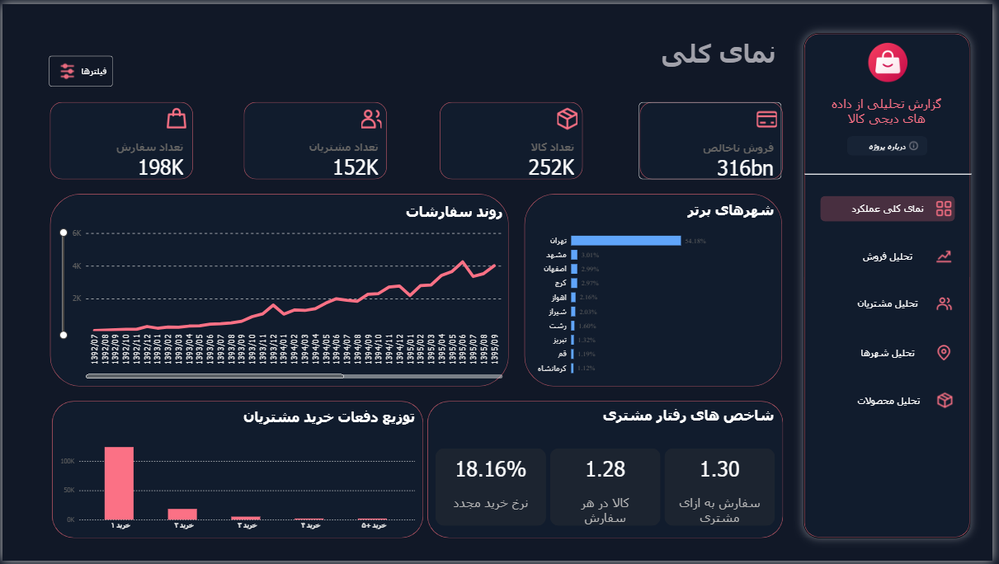

# DigiKala BI Analytics
### End-to-End Business Intelligence | SQL Server · SSIS · Power BI

An independent Business Intelligence portfolio project built around historical e-commerce data from the DigiKala Open Data program.

The project demonstrates an end-to-end workflow: **data ingestion, ETL, dimensional data warehousing, semantic modeling, DAX calculations, and interactive reporting.**

The Power BI report is designed in **Persian (RTL)** using a custom **Graphite & Coral** visual theme.

**Project focus:** Business Intelligence · Data Warehousing · Sales Analytics · Customer Analytics

**Status:** Active development and refinement

**Interactive Dashboard:** Coming soon, subject to data-use permissions and hosting availability.

---

## Dashboard Preview

The reporting solution provides interactive views of order activity, sales patterns, customer behavior, geographic performance, and products.

**Executive Overview**





Additional screenshots of the reporting pages will be included as the project is finalized.

## Project Objectives

The goal of this project is to build a practical Business Intelligence solution using a structured analytical workflow rather than creating dashboards directly from raw source files.

The main objectives are to:

- Design and implement a dimensional data warehouse in SQL Server.
- Develop ETL workflows for importing and preparing data.
- Integrate multiple datasets with incomplete reference relationships.
- Build a star-schema model suitable for analytical queries.
- Create reusable business measures using DAX.
- Design interactive, user-friendly Power BI reports.
- Explore order, customer, product, and geographic patterns.

This project is independent and is not an official DigiKala reporting solution.

## Technology Stack

| Technology | Application |
|---|---|
| SQL Server | Staging database and dimensional data warehouse |
| T-SQL | Data transformations, dimensional loading, validation, and quality checks |
| SQL Server Integration Services (SSIS) | Source-data ingestion and ETL workflows |
| Power BI Desktop | Semantic modeling and interactive report development |
| Power Query | Data preparation and transformations |
| DAX | Business metrics, contextual calculations, and analytical measures |
| GitHub | Source-code management and project documentation |

## Solution Architecture

The implementation follows a layered architecture:


### 1. Source Ingestion and Staging

Four source datasets are imported into SQL Server using SSIS.

The `stg` schema separates source ingestion from downstream analytical transformations and provides a foundation for data validation.

### 2. Data Warehouse Design

A dimensional warehouse was implemented in the `dw` schema using a star-schema approach.

**Fact table**

- `dw.FactOrderLine` — order-line observations, quantities, recorded monetary amounts, and dimension foreign keys.

**Dimension tables**

- `dw.DimDate` — Gregorian and Persian calendar attributes.
- `dw.DimCustomer` — customer identifiers and surrogate keys.
- `dw.DimProduct` — product identifiers and available descriptive attributes.
- `dw.DimCity` — normalized city names and surrogate keys.

The fact table maintains an **order-line grain**. Distinct orders are calculated from `OrderID`, avoiding incorrect order counts caused by multiple line items.

Warehouse surrogate keys are resolved through business-key lookups during fact loading.

### 3. Semantic Modeling

The warehouse tables are imported into Power BI and connected through fact-to-dimension relationships.

The semantic model provides reusable measures for orders, customers, quantities, monetary values, purchasing frequency, and geographic comparisons.

### 4. Reporting Layer

The reporting layer uses a Persian RTL interface with custom navigation, coordinated visual styling, and interactive analysis.

## Power BI Report

The solution is organized into five analytical areas.

| Report Page | Analytical Focus |
|---|---|
| **Executive Overview** | Key performance indicators, order activity, top cities, and purchasing behavior |
| **Sales Analytics** | Temporal analysis, monetary trends, average order value, and calendar patterns |
| **Customer Intelligence** | Purchase frequency, repeat purchases, and observed customer activity |
| **Geographic Insights** | Geographic concentration, city-level comparisons, and changes in city order share |
| **Product Explorer** | Product-level exploration, recorded units, category comparisons, and product trends |

The reporting experience includes features such as:

- Persian right-to-left layout
- Custom Graphite & Coral theme
- Interactive slicers
- Cross-filtering and cross-highlighting
- Navigation buttons
- Bookmark-based filtering interfaces
- Dynamic measures and titles
- Context-sensitive product and geographic analysis

Individual features are reviewed and tested as the report is finalized.

## Selected Analytical Measures

| Measure | Description |
|---|---|
| Total Orders | Distinct number of recorded orders |
| Total Customers | Distinct number of customers with observed orders |
| Total Units | Total quantity of recorded order items |
| Repeat Purchase Rate | Share of customers with at least two distinct orders in the selected context |
| Orders per Customer | Average observed order count per customer |
| Units per Order | Average number of recorded units per order |
| City Order Share | Share of a city's orders relative to orders across all cities |
| Average Order Value | Recorded monetary value per distinct order, subject to validation of the source amount definition |

DAX calculations are designed to respond to applicable report filters and analytical contexts.

## Data Integration and Engineering Challenges

One of the most significant technical challenges in this project was integrating independently sampled datasets with incomplete product-reference coverage.

### Challenge: Unmatched Product Identifiers

During data profiling, many product identifiers in the orders dataset were found to have no corresponding descriptive record in the available product metadata.

Initial analysis of approximately 200,000 order lines indicated that recoverable product titles covered only about **8% of order-line records**, even after consulting supplementary product-related sources.

This figure is provisional and will be verified against the final warehouse before publication.

### Implemented Approach

The following approach was used:

1. Identified unmatched product identifiers through SQL joins and anti-join queries.
2. Consolidated available product IDs and descriptive information from multiple sources.
3. Included product identifiers referenced by the orders dataset in the product dimension.
4. Generated surrogate keys for the dimensional model.
5. Mapped order lines to valid product-dimension records while preserving transactions.
6. Retained unknown descriptive attributes rather than inventing product information.

### Outcome

The dimensional model maintains referential integrity without discarding valid order-line records simply because descriptive product metadata is unavailable.

However, resolving product-key coverage does not recover missing product titles, brands, or categories. Product-level interpretations therefore remain limited to records with sufficient metadata.

This distinction between **referential integrity** and **metadata completeness** is an important part of the project's data-engineering approach.

Detailed implementation notes and validation SQL will be included in the Data Warehouse documentation.

## Data Source and Attribution

The project uses historical datasets attributed to the **DigiKala Open Data Mining Program**.

The files were obtained from a third-party GitHub repository:

**Dataset repository:** [farshadnp/DigiKalaDataSet](https://github.com/farshadnp/DigiKalaDataSet)

**Original program reference:** [DigiKala Open Data](https://www.digikala.com/opendata/)

### Source Files

| Source | Description |
|---|---|
| `orders.csv` | Sampled order-line transactions |
| `product.xlsx` | Product metadata, including available titles, categories, and brands |
| `keifiat.xlsx` | Product-related evaluation records and additional descriptive information |
| `comment.xlsx` | Product-related comment records and identifiers |

The original repository maintainer states that these files were obtained from the DigiKala Open Data program.

**I did not crawl, scrape, collect, or originally publish the source datasets.** My contribution consists of data preparation, integration, data warehouse development, analytical modeling, and report implementation.

The original program requests the following acknowledgment:

> This publication was supported by the Digikala Open Data Mining Program.

This acknowledgment is included for source attribution and does not imply sponsorship or endorsement of this independent project.

## Data Scope and Analytical Limitations

The project uses sampled historical data rather than a complete production transactional database.

The main considerations are:

- Reported values represent the available sample, not total DigiKala operations.
- Product metadata is incomplete for many recorded order items.
- Observed customer histories may not include all historical purchases.
- Product-level analysis is restricted by available descriptive information.
- Financial metrics depend on validating the definition and currency of the recorded monetary field.

These limitations are considered when interpreting analytical results.

### Data Usage

The original data program documentation, as reproduced by the source repository, restricts direct and indirect commercial use without written permission.

The source datasets are not redistributed through this project repository. Public release of original-data-containing PBIX files, semantic models, or interactive reports is subject to appropriate permissions.

An independently generated synthetic dataset may be used for a publicly accessible demonstration where necessary.

## Repository Structure

The intended repository organization is:

```text
digikala-bi-analytics/
├── README.md
├── docs/
│   ├── data-warehouse.md
│   └── metric-definitions.md
├── sql/
│   ├── 01_create_schemas.sql
│   ├── 02_create_dimensions.sql
│   ├── 03_create_fact.sql
│   ├── 04_load_dimensions.sql
│   ├── 05_load_fact.sql
│   └── 06_data_quality_checks.sql
├── etl/
│   └── ssis/
├── powerbi/
│   └── themes/
└── assets/
    └── screenshots/
```

This is the target project structure. SQL scripts, sanitized SSIS packages, technical documentation, and report screenshots will be added as they are reviewed and prepared for publication.

Original source datasets are intentionally excluded.

## Future Documentation

Additional documentation will cover:

- Warehouse schema and data model
- Fact and dimension design
- Surrogate-key mapping
- Data-loading logic
- ETL workflow details
- Data validation queries
- DAX measure definitions
- Report design and interaction logic

## Project Status and Next Steps

The project is being refined for portfolio publication.

Remaining work includes final report validation, technical documentation, source-code organization, screenshot preparation, and evaluation of permitted online publishing options.

A publicly accessible Power BI report link will be added if the necessary data permissions and hosting conditions are satisfied.

---

## Credits

**Data:** DigiKala Open Data Mining Program

**Third-party dataset repository:** [farshadnp/DigiKalaDataSet](https://github.com/farshadnp/DigiKalaDataSet)

**BI implementation:** Independent portfolio project involving SQL Server, SSIS, dimensional modeling, DAX, and Power BI.

**Disclaimer:** This project is not affiliated with, endorsed by, or officially sponsored by DigiKala. All source-data rights remain with their respective owners.
